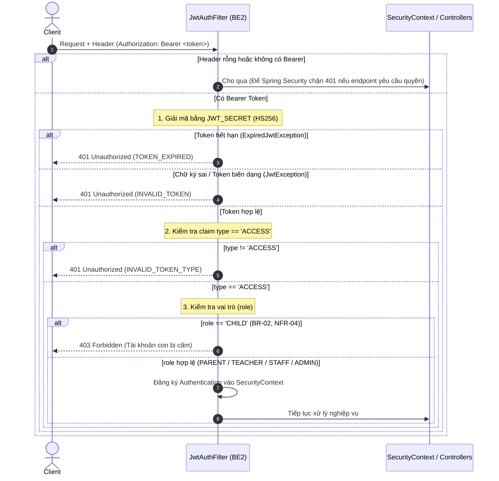

# Hợp đồng Định dạng JWT (JWT Contract between BE1 & BE2)

Tài liệu này xác lập quy chuẩn kỹ thuật bắt buộc giữa **Backend 1 (BE1 - Đơn vị cấp phát Token)** và **Backend 2 (BE2 - Đơn vị tiêu thụ & xác thực Token)**.

---

## 1. Thông số kỹ thuật cốt lõi

| Tiêu chí | Quy định chuẩn | Ghi chú |
| :--- | :--- | :--- |
| **Thuật toán ký (Algorithm)** | `HS256` (HMAC with SHA-256) | Không chấp nhận `none` hoặc các thuật toán không đối xứng khác. |
| **Nguồn khóa bí mật (Secret Key)** | Biến môi trường `JWT_SECRET` | Khóa bí mật dùng chung, tối thiểu 256 bits (32 bytes UTF-8). Tuyệt đối không hard-code trong mã nguồn. |
| **Vị trí truyền Token** | Header `Authorization: Bearer <token>` | Áp dụng cho mọi HTTP request yêu cầu xác thực. |

---

## 2. Cấu trúc Claims trong Payload

Để đảm bảo đồng bộ hoàn toàn giữa BE1 và BE2, payload của JWT bắt buộc phải chứa các trường chuẩn xác sau:

```json
{
  "sub": "123e4567-e89b-12d3-a456-426614174000",
  "userId": "123e4567-e89b-12d3-a456-426614174000",
  "role": "PARENT",
  "type": "ACCESS",
  "iat": 1728900000,
  "exp": 1728986400
}
```

### Chi tiết các Claims:
1. **`userId` (hoặc `sub`)**:
   - Định dạng: Chuỗi UUID v4 chuẩn (String), đại diện cho khóa chính của người dùng (`users.id`).
   - Bắt buộc phải có để BE2 trích xuất định danh người dùng.
2. **`role`**:
   - Định dạng: Chuỗi chữ in hoa (`String`).
   - Các giá trị hợp lệ:
     - `ADMIN`: Quản trị viên hệ thống.
     - `STAFF`: Nhân viên kiểm duyệt / hỗ trợ.
     - `TEACHER`: Giáo viên giảng dạy.
     - `PARENT`: Phụ huynh học sinh.
     - `CHILD`: Tài khoản học sinh (trẻ em).
   - **Quy tắc BR-02 & NFR-04**: BE2 sẽ từ chối truy cập (HTTP `403 Forbidden`) đối với mọi request mang `role = "CHILD"` khi gọi vào các API thương mại, giỏ hàng, đặt hàng, thanh toán và ví tiền.
3. **`type`**:
   - Phân biệt loại Token:
     - `ACCESS`: Token dùng để gọi API tài nguyên.
     - `REFRESH`: Token chỉ dùng cho endpoint cấp lại access token tại BE1.
   - **Quy tắc an toàn của BE2**: BE2 **CHỈ CHẤP NHẬN** token có `type = "ACCESS"`. Nếu client gửi token có `type = "REFRESH"` (hoặc thiếu claim `type`), BE2 sẽ từ chối ngay lập tức với HTTP `401 Unauthorized` (`code = "INVALID_TOKEN_TYPE"`).
4. **`exp`**:
   - Thời điểm hết hạn của token (Unix timestamp tính bằng giây).
   - Khi token quá hạn, BE2 sẽ từ chối với HTTP `401 Unauthorized` (`code = "TOKEN_EXPIRED"`).
5. **`iat`**:
   - Thời điểm phát hành token (Unix timestamp tính bằng giây).

---

## 3. Quy trình xác thực tại BE2 (`JwtAuthFilter`)


